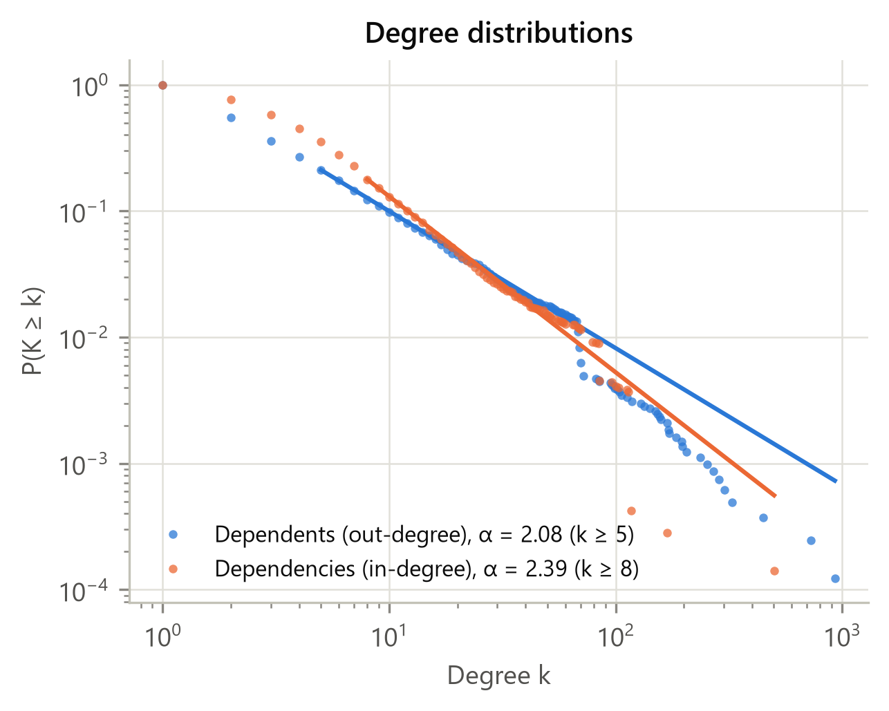
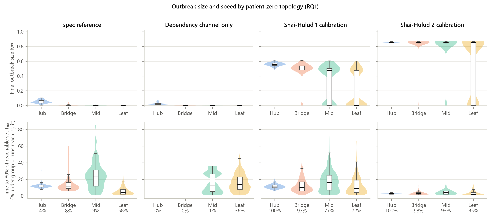
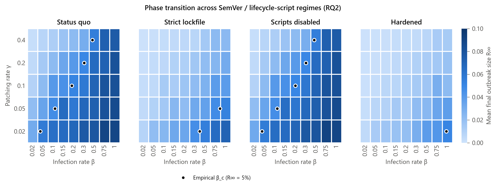
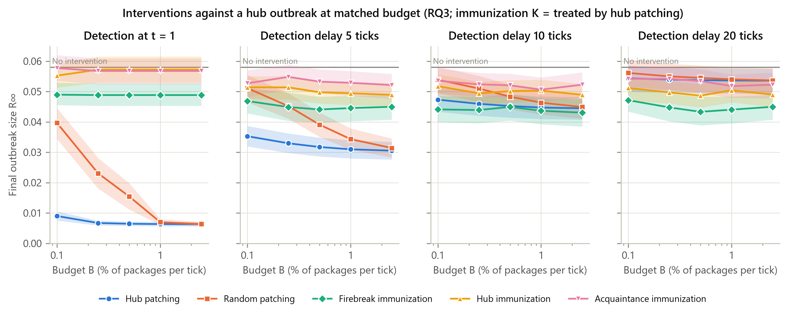

# npm Worms as Epidemics: Project Report

**Super-spreaders, firebreaks and stolen tokens: SIR modelling of self-propagating worms in the npm
dependency network.**

This report tells the whole story of the project, from the first spec to the research-paper draft. It
covers what we built, why we made each decision, what we found, and what went wrong along the way. It is
written to be read on its own, with no code knowledge needed.

---

## Contents

1. [TL;DR](#1-tldr)
2. [The problem](#2-the-problem)
3. [Research questions](#3-research-questions)
4. [How the project unfolded](#4-how-the-project-unfolded)
5. [Data: building the npm graph](#5-data-building-the-npm-graph)
6. [What the network looks like](#6-what-the-network-looks-like)
7. [The model](#7-the-model)
8. [Calibration against the real worms](#8-calibration-against-the-real-worms)
9. [Validation against the real victims](#9-validation-against-the-real-victims)
10. [Results](#10-results)
11. [Robustness checks](#11-robustness-checks)
12. [How the design changed from the original spec](#12-how-the-design-changed-from-the-original-spec)
13. [Bugs and surprises](#13-bugs-and-surprises)
14. [Limitations](#14-limitations)
15. [Repository map and how to reproduce](#15-repository-map-and-how-to-reproduce)
16. [Glossary](#16-glossary)

---

## 1. TL;DR

- **What.** We modelled the 2025 npm worms (Shai-Hulud and Shai-Hulud 2.0) as an SIR epidemic on a
  real 10,000-package npm dependency graph. The epidemic has two ways to spread:
  - **dependencies:** a compromised package infects the packages that depend on it;
  - **stolen credentials:** a leaked publish token lets the worm republish the maintainer's other
    packages.
- **Calibration.** The model is calibrated to the real timelines of both waves, with 1 tick = 1 hour.
- **Validation.** It is checked against the real victim lists. 98% (wave 1) and 95% (wave 2) of victims
  share a maintainer with another victim, against 49% and 69% for random package sets. Stolen tokens
  drove the spread.
- **Key findings.**
  1. **RQ1.** With dependencies alone, only hubs cause outbreaks, and only small ones (about 3–5% of the
     core); leaf packages cause none. With stolen tokens, even a leaf package reaches **8–55%** of the
     graph, depending on graph size and calibration.
  2. **RQ2.** Lockfiles raise the epidemic threshold **12×** and blocking install scripts **6×**, but
     only while tokens cannot be stolen. With stolen tokens, the threshold that matters is the
     token-leak rate. Hardening raises it **7×**, yet the calibrated worms leak tokens faster than every
     regime can absorb, except hardening combined with fast patching for wave-1-like worms.
  3. **RQ3.** Reactive patching works if the worm is detected within hours, but prevents only **13%** of
     the outbreak after a 24-hour delay. **Immunizing hubs in advance** prevents about **42%** at the
     same cost. Degree-based targeting beats betweenness-based "firebreaks" at realistic budgets; at
     very large budgets the two converge.
  4. **Robustness.** Randomly rewiring npm while keeping every package's degrees makes outbreaks
     *larger*, so npm's real layered structure dampens spread.
- **Takeaway for defenders:** break the credential channel first (short-lived tokens, trusted
  publishing), then harden dependencies, and protect central packages in advance.

---

## 2. The problem

npm is the package registry for JavaScript. A typical app depends on hundreds of packages, which depend
on further packages, which forms a huge **directed network**. Every dependency is declared with a
**version range**:

| Range | Accepts | Example |
|---|---|---|
| exact | only that version | `1.2.3` |
| tilde | new patch versions | `~1.2.3` |
| caret | new minor and patch versions | `^1.2.3` |

Loose ranges mean that a new release, including a malicious one, is picked up automatically.

**What happened in 2025:**

| Wave | When | Packages hit | Detection | Spread stopped (plateau) |
|---|---|---|---|---|
| Shai-Hulud | Sept 2025 | ~200 | ~24 h | ~37 h |
| Shai-Hulud 2.0 | Nov 2025 | ~800 | minutes | ~14 h |

The worm's loop:
1. Someone installs a compromised package, and its **install script** runs.
2. The script steals the installer's **npm publish token**.
3. The worm uses the token to **republish** up to 20 (wave 1) or 100 (wave 2) of that maintainer's
   packages, with the malicious script injected.
4. Anyone who installs those packages repeats the loop.

This is contagion on **two coupled networks**: the dependency graph and the "who maintains what" graph.
That makes it a network-science problem.

---

## 3. Research questions

| | Question | Network-science concept |
|---|---|---|
| **RQ1** | Does it matter whether the worm starts at a hub, a bridge, a mid-tier or a leaf package? | Super-spreaders, centrality |
| **RQ2** | Do lockfiles, disabled install scripts or trusted publishing raise the epidemic threshold? | Epidemic threshold, phase transition |
| **RQ3** | With a fixed budget, should we patch infected packages or immunize central ones in advance? | Targeted vs random immunization |

---

## 4. How the project unfolded

The project started from a written spec (`ns-project-outline.md`, kept out of the repository). We
reviewed it, wrote up 20 improvements (`docs/spec-improvements.md`), and then built it in five
milestones. Two further phases followed: a "pre-paper" round to make the results publishable, and the
paper itself.

| Phase | What we built | Key outcome |
|---|---|---|
| **M1: Setup and data** | npm registry crawler, version-range classifier, synthetic graph generator | Real metadata: ranges, install scripts, provenance, maintainers |
| **M2: Graph and topology** | Dependency graph reversed into a contagion graph; centralities, k-core, power-law fits, spectral radius | The graph is almost a DAG; spread is mostly one-directional |
| **M3: SIR engine** | Fast vectorised simulator; NDlib cross-check; patching policies | 100 runs in about 1 s; agrees with NDlib |
| **M4: Experiments** | RQ1–RQ3 runners, metrics, bootstrap CIs, paired comparisons | First results on synthetic and real data |
| **M5: Figures and CLI** | 5 publication figures and a one-command pipeline (`main.py`) | End-to-end reproducible runs |
| **Pre-paper** | Literature review (63 verified references), incident data, calibration, validation, robustness suite, spam cleaning, new hook model | Results that can survive peer review |
| **Paper** | LaTeX draft (`paper/`) with every number generated from the results | Draft of an arXiv preprint |

To speed things up we ran independent work in parallel: the registry crawl in the background while we
wrote code, two research agents (literature review and incident data) at the same time, and Monte Carlo
runs spread across CPU cores.

---

## 5. Data: building the npm graph

**Seeds.** We started from the 4,686 packages with the most dependents, taken from the
`npm-high-impact` list (v1.13.0).

**Crawl.** From the seeds we did a breadth-first crawl of the npm registry, following installed
dependencies (production, optional and peer). Development dependencies are not installed by users, so
we recorded them but did not follow them. For each package we stored:
- every dependency, with its raw version range, classified as exact, tilde, caret, wildcard or
  non-registry;
- whether it has install scripts (`preinstall`, `install`, `postinstall`);
- whether it is published with **provenance** (a verified build);
- its **maintainers**, i.e. who can publish it;
- its ecosystem-wide dependent count, from deps.dev.

**Three graph sizes** from the same seeds:

| Graph | Packages | Edges |
|---|---|---|
| 5k sample | 5,000 | 15,907 |
| **Main graph** | **10,000** | **43,233** |
| Full closure (the crawl ran out of new packages) | 14,624 | 60,041 |

**Spam cleaning.** The full closure contained a **reward-farming spam ring**: 36 fruit-named packages
(`applelemon`, `apricotlongan`, ...) from one maintainer, 25 of which all depend on each other. On its
own this clique pushed the spectral radius to 24. We added an automatic filter that removes dense
mutual-dependency rings. Legitimate monorepos such as `@stdlib` and `@yarnpkg` survive it because they
are much sparser.

**Synthetic benchmark.** We also generated a scale-free directed graph (2,000 nodes) as a controlled
comparison. The raw generator creates a large artificial cycle among hubs, so we orient every edge from
newer to older packages, which makes the graph a DAG like real npm.

---

## 6. What the network looks like



- **Heavy-tailed.** A few packages have hundreds of dependents. A power-law fit gives α = 2.08, but a
  **lognormal fits better** (p = 0.006). Strictly scale-free real networks are rare.
- **Almost a DAG.** There are only 47 small cycles, the largest with 22 packages. Infection therefore
  mostly flows one way, downstream from its origin.
- **Bounded blast radius.** The most transitive dependents of any package is 1,456 of 10,000; the mean
  is 45.
- **Spectral threshold is misleading here.** The spectral radius λmax = 4.92 predicts a threshold of
  τ = 0.20, but it comes entirely from one dense `@stdlib` monorepo cluster, not from the network as a
  whole. On directed graphs, 1/λmax is only a lower bound.

---

## 7. The model

**States.** Each package is **S**usceptible, **I**nfected (it has published a malicious version) or
**R**ecovered (patched, unpublished or protected). One tick is one hour.

**Contagion graph.** If package `u` depends on `v`, infection flows `v → u`, so we reverse the
dependency edges.

**Channel 1, dependencies.** Each hour, an infected package `v` infects each susceptible dependent `u`
with probability

```
p = β × w_semver(u's range) × w_exec(u) × w_prov(u)
```

- `w_semver` is how readily `u`'s range accepts a new release: exact 0.05, tilde 0.85, caret and
  wildcard 1.0.
- `w_exec(u)` is 0.1 if `u`'s maintainers block install scripts, and 1 otherwise. We assume 10% of
  packages block scripts today and 70% in the "scripts disabled" regime.
- `w_prov(u)` reduces infection for provenance-protected packages in the hardened regime.

**Channel 2, stolen credentials.** Each hour, an infected package leaks each of its maintainers' tokens
with probability `β_m`. The worm then republishes up to **20 or 100** of that maintainer's packages,
matching the real caps.

**Recovery.** Infected packages are patched with probability `γ` per hour, but only **after detection**.
Nobody patches a worm they don't know about.

**Interventions** (RQ3, the same budget for every strategy):

| Type | Strategy | What it does |
|---|---|---|
| Reactive | hub patching | patch up to `B` infected packages per hour, highest-degree first |
| Reactive | random patching | patch up to `B` infected packages per hour, at random |
| Proactive | hub immunization | protect the `K` highest-degree packages at the start |
| Proactive | betweenness ("firebreak") | protect the `K` highest-betweenness packages at the start |
| Proactive | acquaintance | protect random neighbours of random nodes (needs no global knowledge) |

**Metrics.**
- **R∞**: the share of packages *ever* infected.
- **T₈₀**: the time to reach 80% of the dependency-reachable set.
- **T₉₀**: the time to the plateau.
- the probability of a major outbreak (R∞ ≥ 5%);
- infection depth;
- the share of infections caused by stolen tokens.

**Statistics.**
- 100 Monte Carlo runs per setting (50 for the large RQ2 grids).
- **Paired seeds**: run *i* has the same starting package and random stream for every strategy, so
  differences are not noise.
- **Bootstrap 95% CIs**: outbreak sizes are bimodal, so normal-theory CIs would be wrong.

**Implementation check.** With uniform weights, our engine and the NDlib library give the same mean
outbreak size within sampling error. Our engine is about 30× faster.

---

## 8. Calibration against the real worms

From vendor reports and registry timestamps (see `docs/incident-notes.md`) we know each wave's detection
lag, per-token cap and time to plateau. We grid-searched `β`, `β_m` and `γ` so that simulated outbreaks:
- plateau at the same time as the real ones, and
- get about 75% of infections from stolen tokens (in wave 2, about 570 of about 800 victims had no
  dependents at all).

| | Wave 1 (SH1) | Wave 2 (SH2) |
|---|---|---|
| Detection lag (patching starts) | 24 h | ~0 h |
| Packages per stolen token | 20 | 100 |
| Plateau: observed / model | 37 h / 41.5 h | 13.4 h / 14.0 h |
| Share via stolen tokens | 76% | 77% |
| Fitted β / β_m / γ | 0.02 / 0.02 / 0.10 | 0.20 / 0.10 / 0.05 |

Both fits lie inside the search grid, so they are not artifacts of its boundaries.

**Caveat.** The data pin down timing and channel mix, but **not** the patching rate γ or the absolute
outbreak size. Outbreak sizes in the high-impact core are therefore **projections**: what would happen
if a worm with Shai-Hulud's dynamics got into the core.

---

## 9. Validation against the real victims

If stolen tokens drive the spread, victims should share maintainers with each other. We checked this
against the real compromised-package lists, using only registry metadata and never downloading package
code.

| | Wave 1 | Wave 2 |
|---|---|---|
| Victims analysed | 189 | 732 |
| Share with a **co-maintained** fellow victim | **98%** (random sets: 49%) | **95%** (random sets: 69%) |
| Share **dependency-linked** to a fellow victim | 32% (random sets: 5%) | 23% (random sets: 14%) |
| Victims inside our high-impact graphs | 2 | 0–7 |

**Conclusions.**
- Victims cluster by **maintainer** much more than by dependency link, which confirms the credential
  channel.
- The real waves spread through small maintainers in the **periphery**, not through the core.
- This framing carries through the whole paper.

---

## 10. Results

### RQ1: Does the origin matter?



Mean share of the core ever infected (1,000 runs per group):

| Scenario | Hub | Bridge | Mid-tier | Leaf |
|---|---|---|---|---|
| Spec reference (β = 0.15, no tokens) | 5.3% | 0.8% | 0.2% | 0.0% |
| Dependencies only (SH1 rates) | 2.6% | 0.2% | 0.0% | 0.0% |
| **SH1 calibrated** | 55.8% | 48.7% | 31.8% | **19.6%** |
| **SH2 calibrated** | 85.8% | 84.2% | 78.8% | **55.4%** |

- **Without tokens** the classic super-spreader picture holds: only hubs matter, and even they reach
  little, because the graph is almost a DAG.
- **With tokens** a leaf package can take over much of the core. Outbreaks become bimodal: they either
  fizzle before a token leaks or explode. Origin changes the *probability* of take-off more than the
  final size.
- **Graph size matters for the leaf figure.** These are shares of the 10k graph. Under SH1, leaf
  outbreaks reach 22.4% of the 5k sample, 19.6% of the 10k graph and 7.8% of the full closure (roughly
  1,100–2,000 packages in absolute terms), so treat it as a range.

### RQ2: Which defences raise the epidemic threshold?



Critical transmission rate βc (where mean R∞ reaches 5%), dependencies only, at γ = 0.02:

| Regime | βc | vs status quo |
|---|---|---|
| Status quo | 0.045 | — |
| Strict lockfiles (80% of ranges pinned) | 0.514 | **~12×** |
| Scripts disabled (70% of packages block scripts) | 0.279 | **~6×** |
| Hardened (lockfiles, scripts off, provenance on top hubs) | never a major outbreak | — |

- Dependency-side hardening clearly works while tokens are safe.
- **With stolen tokens** at the calibrated rates, βc drops to the bottom of our grid (0.001) in 75% of
  cases: the credential channel sustains the epidemic on its own. The threshold that matters is then
  the **token-leak rate β_m**.

**RQ2b: critical token-leak rate β_m,c** (β fixed at the SH1 value):

| Regime | γ = 0.02 | γ = 0.05 | γ = 0.1 | γ = 0.2 | γ = 0.4 |
|---|---|---|---|---|---|
| Status quo | ≤0.001 | 0.001 | 0.002 | 0.008 | 0.020 |
| Strict lockfile | 0.001 | 0.002 | 0.005 | 0.015 | 0.031 |
| Scripts disabled | ≤0.001 | 0.001 | 0.004 | 0.012 | 0.028 |
| Hardened | 0.002 | 0.006 | 0.015 | 0.038 | 0.087 |

- Faster patching and hardening both raise the threshold; hardening raises it about **7×** at γ = 0.1.
- The calibrated **wave-2** worm (β_m = 0.1) is above the threshold of **every** regime.
- The calibrated **wave-1** worm (β_m = 0.02) is about **10×** above the status-quo threshold at
  γ = 0.1. It falls below threshold only with fast patching: at γ = 0.2 only when hardened, and at
  γ = 0.4 also with lockfiles or disabled scripts.
- So dependency-side hardening helps against stolen tokens too, but not enough on its own.

### RQ3: Patch reactively or immunize proactively?



Share of the outbreak prevented, at a budget of 50 packages per hour (SH1 parameters, same total
budget for every strategy):

| Strategy | 1 h | 6 h | 12 h | 24 h | 48 h |
|---|---|---|---|---|---|
| Reactive: patch hubs first | 100% | 90% | 52% | 13% | 3% |
| Reactive: patch at random | 100% | 76% | 23% | 5% | 1% |
| **Proactive: immunize hubs** | 6% | 23% | 38% | **42%** | 40% |
| Proactive: acquaintance | 3% | 17% | 32% | 35% | 34% |
| Proactive: betweenness | 3% | 13% | 27% | 29% | 26% |

- **Fast detection: react.** Within an hour, patching contains almost everything.
- **Slow detection: protect in advance.** The two approaches cross over between 12 and 24 hours of
  delay, and wave 1 took about 24 hours to detect.
- **Degree beats betweenness at realistic budgets.** This surprised us, since the original spec expected
  betweenness "firebreaks" to win. Matching budgets is costly: at 50 per hour, proactive strategies
  immunize 1,253 packages (12.5% of the graph). Degree wins at every budget up to 1% of packages per
  hour. Only at the largest budget we tested (2.5% per hour, 2,649 packages) does betweenness edge
  ahead (65% vs 62%). A plausible reason for degree's advantage is that stolen tokens bypass the
  dependency paths that betweenness cuts. Optimised immunization sets could beat both heuristics, so we
  don't claim optimality.

---

## 11. Robustness checks

| Check | Status | Result so far |
|---|---|---|
| 6 synthetic graphs (different seeds) | ✅ done | Hub immunization is the best response in 6 of 6; hubs reach 38 ± 5%, leaves 5 ± 3% |
| Sample size (5k / 10k / full closure) | ✅ done | Same qualitative pattern; SH1 leaf reach 22% / 20% / 8% of the graph |
| Degree-preserving rewirings (null models) | ✅ 4 of 5 done, last running | Rewired graphs spread **more**: dependency-only hubs 7.6–8.1% vs 2.6%; SH1 leaves 32–43% vs 20%. npm's real wiring dampens outbreaks |
| β × γ sensitivity around SH1 (9 settings, 50 runs each) | ⏳ running | Is the RQ3 ranking stable? |
| RQ2b: critical token-leak rate per regime | ✅ done | See RQ2 above: hardening raises it 7×, still not enough for SH2 |

The remaining runs execute in the background with resume support. Once they finish,
`python -m src.paper_numbers` updates every number in the paper.

---

## 12. How the design changed from the original spec

| Original spec | What we changed | Why |
|---|---|---|
| Dependency contagion only | **Added a stolen-credential channel** | That is how Shai-Hulud actually spread |
| Install-script boost (×1.25) on packages that declare hooks | **Worm-injected scripts; consumers can block them** | The spec version made "scripts disabled" useless by construction (only 1% of packages declare hooks) |
| Worm republishes all of a maintainer's packages | **Cap of 20 or 100 per token** | Matches the real worms |
| Constant patching from t = 0 | **Patching starts at detection** | Nobody patches an undetected worm |
| Outbreak size = \|R(T)\| / N | **Share ever infected** | \|R\| also counts immunized and patched nodes, so it would overstate damage exactly when defences work |
| Random SemVer and provenance attributes | **Read from real registry data** | Realism |
| Normal-theory confidence intervals | **Bootstrap CIs, paired seeds, P(major outbreak)** | Outbreak sizes are bimodal |
| Fixed budgets (e.g. 50 per tick) | **Budgets as a share of N; matched budgets for proactive strategies** | Fair comparison across graph sizes and strategies |
| One detection setting | **Sweep of detection delays (1–48 h)** | The strategy ranking depends on it |
| Raw `scale_free_graph` | **Simple, acyclic orientation** | The raw generator's hub cycle inflated λmax |
| — | **Spam-ring cleaning, calibration, validation, null models** | Needed for publishable claims |

The full list with details is in `docs/spec-improvements.md`.

---

## 13. Bugs and surprises

Real projects hit snags. These were the instructive ones:

1. **Synthetic graph cycle.** NetworkX's `scale_free_graph` creates a 91-node cycle among hubs that real
   npm doesn't have. Fixed by orienting edges newer → older.
2. **Crawl bias.** Our first small crawl had a maximum blast radius of only 12, because crawling
   *downwards* from popular packages misses most of their dependents. Fixed by seeding from the
   high-impact list.
3. **A package named `nan`.** npm has a popular package literally called `nan`, and pandas read its name
   as "not a number" when loading cached results. Fixed with explicit CSV parsing and a regression
   test.
4. **The spam ring** (Section 5) dominated the spectral analysis until we filtered it out.
5. **The hook model** produced a "scripts disabled" effect of zero, which contradicted the real incident.
   This led to the worm-injected redesign.
6. **Firebreaks lost, mostly.** After calibration, the spec's hypothesis that betweenness firebreaks
   win held only at the very largest budget; at realistic budgets degree-based immunization wins. We
   report it as it came out.
7. **Memory limits.** On a 7.7 GB laptop, long parallel runs were stopped for using too much memory. We
   added resumable runs that skip finished work, but only if its saved settings match the current run.
   An earlier version of the resume check accepted leftover 1-run smoke-test files as finished, so we
   added the settings check and a test for it.
8. **Macro name collision.** In the paper's number generator, the "SH1" and "SH2" scenario names both
   collapsed to the same LaTeX macro, so one silently overwrote the other. Now caught by a duplicate
   check.

---

## 14. Limitations

- **Core, not all of npm.** The real waves hit the periphery, so sizes in the core are projections.
- **Assumed adoption shares.** We found no measurement of how many packages block install scripts; the
  10% and 70% shares are assumptions.
- **Today's metadata.** Maintainers and dependencies were fetched in 2026, not at the incident dates.
- **Heuristic immunization.** Our strategies are static degree and betweenness sets; optimised sets
  could do better.
- **CI compromise.** Trusted publishing does not stop a compromised CI pipeline (s1ngularity, Mini
  Shai-Hulud).

---

## 15. Repository map and how to reproduce

```
src/
  data_ingestion.py    registry crawler, version-range classifier, synthetic generator
  graph_builder.py     dependency → contagion graph, spam-ring cleaning
  topology_analyzer.py centralities, k-core, power-law fits, spectral radius, node groups
  sir_engine.py        two-channel SIR engine, policies, batched Monte Carlo, NDlib baseline
  metrics_logger.py    per-run metrics, bootstrap CIs, thresholds, paired reductions
  experiments.py       RQ1, RQ2, RQ2b, RQ3 runners
  calibration.py       fit to the Shai-Hulud timelines
  validation.py        test against real victim lists (metadata only)
  robustness.py        null models, synthetic ensembles, sample sizes, sensitivity
  paper_suite.py       frozen settings; one command runs every paper experiment
  paper_numbers.py     writes every number and table the paper cites
  visualizer.py        the 5 figures
main.py                end-to-end pipeline command
paper/                 LaTeX draft (main.tex, sections/, generated/)
docs/                  this report, literature review, incident notes, spec changes
tests/                 116 automated tests
```

Reproduce everything:

```bash
pip install -r requirements-lock.txt
python -m src.data_ingestion crawl --seeds data/raw/seeds_high_impact_dependents.txt --max-nodes 10000 --dependents --out data/raw/npm_hi_n10k.jsonl
python -m src.calibration data/processed/npm_hi_n10k_contagion.pkl --jobs 4
python -m src.validation
python -m src.paper_suite all --jobs 4      # every experiment
python -m src.paper_numbers                 # numbers and tables for the paper
python -m pytest -m "not network"           # 116 tests
```

The README has the exact crawl commands for all three graph sizes.

---

## 16. Glossary

| Term | Meaning |
|---|---|
| **SIR model** | Epidemic model in which nodes are Susceptible, Infected or Recovered; recovered nodes stay immune |
| **Contagion graph** | The dependency graph with edges reversed, so infection flows from a package to its dependents |
| **R∞ (outbreak size)** | Share of packages ever infected |
| **Epidemic threshold** | Critical transmission rate above which large outbreaks occur (a phase transition) |
| **Spectral radius λmax** | Largest eigenvalue of the contagion matrix; 1/λmax is a classic threshold estimate (only a lower bound on directed graphs) |
| **DAG** | Directed acyclic graph: no cycles, so flow goes one way |
| **Strongly connected component (SCC)** | A set of nodes that can all reach each other, i.e. a cycle structure |
| **Hub / super-spreader** | A package with very many dependents (high out-degree in the contagion graph) |
| **Betweenness centrality** | How often a node lies on shortest paths between others, i.e. a "bridge" |
| **k-core** | The maximal subgraph in which every node has at least k neighbours |
| **Acquaintance immunization** | Immunize random neighbours of random nodes; finds hubs without global knowledge |
| **Null model (degree-preserving rewiring)** | Shuffle the edges while keeping every node's degree, to test whether the exact structure matters |
| **Lockfile / pinning** | Freezing exact dependency versions so new releases aren't picked up automatically |
| **Install script** | Code npm runs automatically when a package is installed (`preinstall` / `postinstall`) |
| **Trusted publishing / provenance** | Publishing tied to a verified CI identity, so a stolen token alone cannot publish |
| **Bootstrap CI** | Confidence interval from resampling the runs; makes no normality assumption |
| **Paired runs** | Every strategy gets the same random draws, so differences reflect the strategy, not luck |
